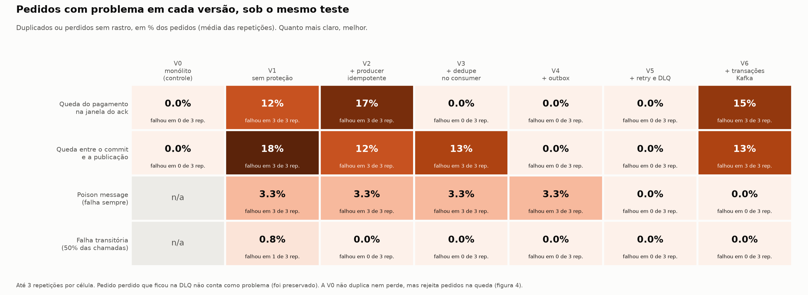

# TCC: Garantias de Entrega em Sistemas Orientados a Eventos

## Objetivo

Este projeto é o experimento prático de um Trabalho de Conclusão de Curso sobre **garantias de entrega de mensagens** (delivery guarantees) em arquiteturas orientadas a eventos baseadas em Apache Kafka.

### Problema de pesquisa

Sistemas distribuídos que se comunicam via mensageria assíncrona estão sujeitos, por natureza, a falhas parciais: quedas de broker, falhas de rede, crashes de serviço no meio do processamento de uma mensagem. Sem tratamento explícito, essas falhas tipicamente resultam em **duplicação de eventos** (reprocessamento) ou **perda de eventos** (mensagens nunca publicadas ou nunca processadas), comprometendo a consistência do domínio de negócio — por exemplo, um pagamento cobrado duas vezes ou uma baixa de estoque que nunca ocorre.

Este trabalho investiga, de forma empírica, o quanto cada técnica de garantia de entrega (idempotência de producer, idempotência de consumer, transactional outbox, retry com dead-letter queue, transações Kafka) reduz a taxa de duplicação e perda observada sob diferentes cenários de falha injetada, e a que custo (latência, complexidade, throughput).

### Abordagem experimental

O sistema modela um fluxo de e-commerce simplificado — **criação de pedido → processamento de pagamento → baixa de estoque** — implementado em múltiplas versões incrementais:

- **Versão 0:** monólito transacional (baseline de controle, sem mensageria)
- **Versão 1:** três serviços distribuídos via Kafka, sem nenhuma proteção (baseline de falha)
- **Versão 2:** producer idempotente
- **Versão 3:** idempotência de consumer
- **Versão 4:** transactional outbox pattern
- **Versão 5:** retry com backoff exponencial + dead-letter queue
- **Versão 6:** transações Kafka (exactly-once real, read-process-write)

Cada versão é submetida à mesma matriz de cenários de falha injetada (queda de broker, queda de serviço, latência de rede, partição de rede, falha aleatória de aplicação, falha de banco de dados), sob carga controlada, e as métricas de duplicação, perda e tempo de recuperação são comparadas entre versões.


## Stack

Java 21, Spring Boot 4.1, PostgreSQL, Apache Kafka (modo KRaft), Docker Compose, Testcontainers, Toxiproxy, k6.

## Estrutura do repositório

```
.
├── docker-compose.yml           # Kafka (KRaft) + PostgreSQL + os três serviços (+ monólito, no profile v0)
├── docker-compose.override.yml  # nomes fixos dos containers
├── docker-compose.toxiproxy.yml # camada de falha de rede (Toxiproxy), usada pela bateria
├── docker/postgres/             # script de inicialização (schemas)
├── monolito-pedidos/            # versão 0 (baseline monolítico)
├── order-service/
├── payment-service/
├── stock-service/
├── integration-tests/           # testes de integração (Testcontainers)
├── benchmark/                   # bateria única de experimentos e script do gráfico
├── failure-injection/           # scripts avulsos de falha (Fases 3 e 4)
└── results/                     # dados coletados dos experimentos
```

## Subindo o ambiente

```bash
docker compose up -d --build              # sobe a versão padrão (v5)
VERSAO=v3 docker compose up -d --build    # sobe outra versão (v1 a v6)
```

Isso sobe:
- **Kafka** (modo KRaft, sem Zookeeper) — acessível em `localhost:29092` a partir do host, e em `kafka:9092` a partir de outros containers na rede `tcc-network`.
- **PostgreSQL** — acessível em `localhost:5433` (usuário/senha/banco: `tcc`/`tcc`/`tcc_pedidos`), com os schemas `pedido`, `pagamento` e `estoque` já criados na inicialização. A porta publicada é `5433` (não a padrão `5432`) porque nesta máquina já existe um PostgreSQL nativo do Windows escutando em `5432`, que entraria em conflito com o do Docker.

Para validar que o ambiente subiu corretamente:

```bash
docker exec kafka /opt/kafka/bin/kafka-topics.sh --bootstrap-server localhost:9092 --list
docker exec postgres psql -U tcc -d tcc_pedidos -c "\dn"
```


## Versões como configuração

A partir da Fase 9, as versões **V1 a V6 são o mesmo código**, e cada uma é uma configuração que liga ou desliga proteções. Foi o que tornou possível rodar **exatamente o mesmo teste** em todas. A versão é escolhida pela variável `VERSAO` (padrão `v5`) e cada proteção é um *profile* do Spring, em `application-<proteção>.properties`:

| Versão | Profiles ligados | Proteção adicionada |
|---|---|---|
| v1 | (nenhum) | baseline sem proteção |
| v2 | `producer-idempotente` | producer idempotente |
| v3 | + `dedupe` | idempotência de consumer |
| v4 | + `outbox` | transactional outbox |
| v5 | + `retry-dlq` | retry com backoff e DLQ |
| v6 | + `transacoes` | transações Kafka (read-process-write) |

A **V0** (monólito) continua sendo outro programa (`monolito-pedidos/`), no profile `v0` do compose, com a API na porta 8090.

Os ganchos de falha são iguais em todas as versões e se controlam por variáveis de ambiente do compose:

| Variável | Efeito |
|---|---|
| `ATRASO_ACK_MS` | espera antes de confirmar (`ack`) a mensagem de entrada no `payment-service` |
| `ATRASO_PUBLICACAO_{ORDER,PAYMENT,STOCK}_MS` | alarga a janela entre o passo de banco e a publicação (espera antes do envio, nas V1 a V3; idade mínima do evento na outbox, na V4 em diante) |
| `PRODUTO_ENVENENADO` | `produtoId` que faz o processamento falhar sempre (poison message) |
| `FAILURE_RATE` | percentual (0 a 100) das chamadas do pagamento que falham de forma aleatória |
| `SESSION_TIMEOUT_MS`, `HEARTBEAT_MS` | tempos do consumer group (reentrega mais rápida nos testes) |
| `LISTENER_CONCURRENCY` | threads do consumer do pagamento (a bateria usa 3, uma por partição) |
| `KAFKA_BOOTSTRAP`, `DB_HOSTPORT` | passam o tráfego pelo Toxiproxy (cenários de rede) |

**Como sabemos que a configuração equivale à versão original.** Cada proteção foi conferida com um teste diferencial, trocando só `VERSAO`:

| Teste | Resultado |
|---|---|
| Replay de offsets | v2: 2 pagamentos e estoque tirado 3 vezes; v3: 1 e 1 |
| Queda entre gravar e publicar | v2: 2 pagamentos; v3: pedido `PENDENTE` para sempre; v4: `CONCLUIDO` com 1 pagamento |
| Mensagem envenenada | v4: 10 tentativas e a mensagem some; v5: 4 tentativas e vai para a DLQ |
| Suíte de integração (6 testes) | passa na configuração padrão (v5) |

As seções das Fases 3 a 7, abaixo, foram escritas quando cada versão ainda era uma tag. Seus números seguem valendo como **validação do mecanismo de cada versão**. A comparação entre versões está na seção da bateria única, no fim.

## Fase 3 — Resultado de controle (Versão 1: baseline sem proteção)

**Objetivo:** reproduzir, de forma controlada, a duplicação de efeito de negócio quando um consumidor cai no meio do processamento. Esse é o "resultado de controle" que justifica as proteções das próximas versões.

### Mecanismo

O `payment-service` consome `pedidos.criados`, grava o `Pagamento` no seu schema e publica `pagamentos.processados`. O offset da mensagem só é commitado no Kafka **depois** que o listener termina (semântica *at-least-once*). Se o processo morrer entre "já gravei o pagamento" e "confirmei o offset" (a **janela vulnerável**), o Kafka não sabe que a mensagem foi tratada e a **reentrega** quando o serviço volta, e o pagamento é gravado uma segunda vez. Como a Versão 1 não tem idempotência no producer, nem deduplicação no consumer, nem outbox, nada impede isso.

O pedido ainda fecha como `CONCLUIDO`, então a falha é silenciosa: só aparece contando as linhas de `pagamento.pagamento`.

### Cenário testado

`failure-injection/kill-payment-service.sh [espera_ms]`:

1. aquece o `payment-service` com um pedido descartável (a primeira mensagem após um restart é lenta e mascara o tempo medido);
2. cria o pedido de teste via `POST /pedidos`;
3. espera `espera_ms` e executa `docker kill payment-service` (SIGKILL, sem desligamento limpo);
4. reinicia o container e consulta periodicamente quantas linhas existem em `pagamento.pagamento` para o pedido.

A reentrega não é imediata: o consumer group só reatribui as partições depois que o *session timeout* do consumidor morto expira (cerca de 40 s com o padrão de 45 s).

Scripts de apoio:

- `failure-injection/varrer-falha.sh [repeticoes] [valores_ms...]` repete o cenário para vários tempos de espera e grava um CSV em `results/<versao>/`, com o atraso do ack e o session timeout registrados em colunas.
- `failure-injection/varrer-janela.sh [repeticoes] [atrasos_ms...]` varre o tamanho da janela vulnerável: para cada atraso, recria o `payment-service` com ele e chama o `varrer-falha.sh`.

### Configuração do experimento

O listener do `payment-service` usa `ack-mode=manual` e permite inserir um atraso entre o processamento e o `ack`, controlado por `app.demo.atraso-ack-ms` (variável `ATRASO_ACK_MS` no `docker-compose`). O session timeout do consumer também é configurável (`SESSION_TIMEOUT_MS` e `HEARTBEAT_MS`):

| Modo | Configuração | Janela vulnerável |
|---|---|---|
| Natural | `ATRASO_ACK_MS=0` (padrão) | alguns milissegundos |
| Amplificado | `ATRASO_ACK_MS=800` | 800 ms |

```bash
ATRASO_ACK_MS=800 docker compose up -d payment-service
```

Nas varreduras de tamanho de janela o session timeout foi reduzido para 6 s, só para detectar o consumidor morto mais rápido (a reentrega passou de ~40 s para 10–14 s). Isso não altera o mecanismo: o offset não foi commitado de qualquer forma, e o resultado do modo amplificado se manteve.

### Resultado 1: janela amplificada (800 ms)

Dados brutos: [`results/v1/varredura-atraso800ms-20261005.csv`](results/v1/varredura-atraso800ms-20261005.csv). 9 tempos de espera × 3 repetições = 27 execuções, com o session timeout padrão (45 s).

| Espera (ms) | Execuções | Com duplicação | Linhas em `pagamento.pagamento` por pedido | Status final |
|---|---|---|---|---|
| 0 | 3 | 3 | 2 | CONCLUIDO |
| 2 | 3 | 3 | 2 | CONCLUIDO |
| 5 | 3 | 3 | 2 | CONCLUIDO |
| 8 | 3 | 3 | 2 | CONCLUIDO |
| 10 | 3 | 3 | 2 | CONCLUIDO |
| 15 | 3 | 3 | 2 | CONCLUIDO |
| 20 | 3 | 3 | 2 | CONCLUIDO |
| 30 | 3 | 3 | 2 | CONCLUIDO |
| 50 | 3 | 3 | 2 | CONCLUIDO |

**27 de 27 execuções duplicaram**, sempre com exatamente 2 linhas por pedido (uma reentrega por falha).

### Resultado 2: duplicação em função do tamanho da janela

Espera fixa em 0 ms, 5 repetições por tamanho de janela (30 execuções), session timeout de 6 s. Os resultados são contagens (k de n), não percentuais: com n = 5 uma taxa estimada seria pouco estável.

| Janela (atraso do ack) | Execuções com duplicação | Dados brutos |
|---|---|---|
| 0 ms (natural) | 0 de 5 | [csv](results/v1/varredura-atraso0ms-20261005-042530.csv) |
| 50 ms | 0 de 5 | [csv](results/v1/varredura-atraso50ms-20261005-042842.csv) |
| 100 ms | 0 de 5 | [csv](results/v1/varredura-atraso100ms-20261005-043156.csv) |
| 200 ms | 0 de 5 | [csv](results/v1/varredura-atraso200ms-20261005-043507.csv) |
| 400 ms | **3 de 5** | [csv](results/v1/varredura-atraso400ms-20261005-043822.csv) |
| 800 ms | **5 de 5** | [csv](results/v1/varredura-atraso800ms-20261005-044052.csv) |

A duplicação aparece quando a janela é grande o suficiente e cresce com ela: nenhuma ocorrência até 200 ms, ocorrência parcial em 400 ms e em todas as execuções em 800 ms.

### O modo natural foi testado, mas não é mensurável com `docker kill` externo

A linha de 0 ms da tabela acima (0 de 5) **não** deve ser lida como "a V1 não duplica no modo natural". Ela reflete o limite do método de medição:

- O `payment-service` termina de processar a mensagem **antes** de o script receber a resposta do `POST` (nas medições, dezenas de milissegundos antes), e a janela natural entre gravar e confirmar o offset dura poucos milissegundos.
- O script só começa a contar a espera depois que o `POST` retorna, e o próprio comando `docker kill` levou cerca de 470 ms para executar numa medição.
- Portanto o `kill` chega depois do `ack`, e não há como acertar a janela natural com esse método, qualquer que seja o tempo de espera. O padrão 0% até 200 ms e 3 de 5 em 400 ms é consistente com o `kill` atingindo o processo algumas centenas de milissegundos depois do processamento.

Medir a taxa natural exigiria injetar a falha de dentro do processo (ou com controle de tempo na escala de milissegundos), o que está fora do escopo desta fase.

### Conclusão

Na Versão 1, uma queda do consumidor entre o processamento e o commit do offset **duplica o efeito de negócio** (dois pagamentos para o mesmo pedido), sem nenhum erro visível, e a ocorrência cresce com o tamanho dessa janela. O mecanismo está demonstrado; a frequência natural não pôde ser medida e fica registrada como limitação. Esse resultado é o ponto de comparação para as próximas versões.

### Limitações e pendências

- **A taxa natural de duplicação não foi medida** (ver a seção anterior). Os resultados provam o mecanismo e a dependência do tamanho da janela, não a frequência da falha em produção.
- **Amostra pequena:** 5 execuções por tamanho de janela (3 por espera no resultado 1). A transição entre 200 ms e 800 ms não foi detalhada.
- **O cenário de perda não foi reproduzido.** Ele exigiria derrubar o `order-service` entre gravar o pedido e publicar o evento.
- **O efeito no `stock-service` não foi medido nas rodadas de falha desta fase.** A mensagem duplicada também é publicada de novo e o estoque pode ser reservado duas vezes; esse efeito em cascata foi observado depois, no replay da Fase 5 (ver abaixo).
- **O baseline difere ligeiramente da V1 original:** o listener usa ack manual e não tem `@Transactional`, para que a gravação já esteja commitada quando o atraso começa.

## Fase 4 — Versão 2: producer idempotente

**Objetivo:** eliminar a duplicação na **escrita do broker** causada por retries do producer, e confirmar que a duplicação de **efeito de negócio** no consumer (resultado da Fase 3) continua existindo nesta versão.

### Configuração

Nos três serviços que publicam (`order-service`, `payment-service`, `stock-service`), o `application.properties` passou de `enable.idempotence=false` (propositalmente desligado na V1) para:

```properties
spring.kafka.producer.acks=all
spring.kafka.producer.properties.enable.idempotence=true
spring.kafka.producer.properties.max.in.flight.requests.per.connection=5
```

Com isso o producer recebe um *producer id* e numera cada mensagem por partição. Se um retry reenviar uma mensagem que o broker já gravou, o broker reconhece o número de sequência repetido e descarta o duplicado. Nos logs de cada serviço, a configuração efetiva aparece como `enable.idempotence = true`, `acks = -1` (equivale a `all`) e `max.in.flight.requests.per.connection = 5`.

### Teste: o retry não duplica no broker

`integration-tests/.../ProducerIdempotenteIntegrationTest.java` (`cd integration-tests && ./mvnw test -Dtest=ProducerIdempotenteIntegrationTest`):

1. sobe um Kafka (`apache/kafka:3.8.0`) e um Toxiproxy na mesma rede, com o endereço anunciado pelo Kafka apontando para o proxy, para que todo o tráfego do producer passe por ele;
2. envia uma mensagem de aquecimento (cria o tópico e a sessão do producer);
3. injeta no proxy um *timeout* no sentido broker → producer, que engole os acks, e envia a mensagem de teste: o request **chega** ao broker e é gravado, mas o producer não recebe a confirmação, estoura `request.timeout.ms` (2 s) e reenvia;
4. remove a falha e conta os registros do tópico pelos offsets (início e fim da partição).

| Producer | Registros no tópico (1 aquecimento + 1 teste) | Interpretação |
|---|---|---|
| `enable.idempotence=true` | **2** | o retry foi deduplicado pelo broker |
| `enable.idempotence=false` (controle) | **3** | o retry foi gravado de novo |

O teste de controle prova que a falha de rede injetada realmente provoca duplicação, ou seja, que o resultado com idempotência é significativo. O resultado foi o mesmo (2 e 3) nas 3 execuções consecutivas em que as contagens foram registradas.

### Resultado: a duplicação de efeito no consumer continua

A mesma varredura de tamanho de janela da Fase 3 (`VERSAO=v2 failure-injection/varrer-janela.sh 5 0 50 100 200 400 800`: espera de 0 ms, 5 repetições por janela, session timeout de 6 s), agora com o producer idempotente. Dados brutos em [`results/v2/`](results/v2/).

| Janela (atraso do ack) | V1: com duplicação | V2: com duplicação |
|---|---|---|
| 0 ms (natural) | 0 de 5 | 0 de 5 |
| 50 ms | 0 de 5 | 0 de 5 |
| 100 ms | 0 de 5 | 0 de 5 |
| 200 ms | 0 de 5 | 0 de 5 |
| 400 ms | 3 de 5 | 3 de 5 |
| 800 ms | 5 de 5 | 5 de 5 |

O comportamento é o mesmo da V1, e isso é o esperado: a duplicação demonstrada na Fase 3 não vem de retry do producer, e sim de **reprocessamento no consumer** (o serviço cai depois de gravar o pagamento e antes de confirmar o offset, e o Kafka reentrega a mensagem). O producer idempotente não atua nesse caminho. As mesmas limitações da Fase 3 valem aqui, em especial a de que a taxa natural não é mensurável com `docker kill` externo.

### Conclusão

A V2 elimina a duplicação na escrita do broker: com um ack perdido e retry, o tópico fica com um único registro, contra dois sem idempotência. A duplicação de efeito de negócio no consumer permanece, e só será tratada na Fase 5 (idempotência de consumer).

### Limitações

- O teste de deduplicação usa um producer Kafka puro, configurado como o dos serviços (`acks=all`, `enable.idempotence=true`, `max.in.flight=5`), e não o `KafkaTemplate` do Spring dentro dos serviços. A configuração efetiva dos serviços foi conferida nos logs.
- O teste roda contra um Kafka próprio (`apache/kafka:3.8.0`) com o cliente `kafka-clients` na versão do Spring Boot do projeto.
- A falha injetada perde os acks de uma única mensagem; não cobre outros modos de falha (queda de broker, partição de rede), previstos para a Fase 9.
- Amostra de 5 execuções por tamanho de janela, como na Fase 3.

## Fase 5 — Versão 3: idempotência de consumer

**Objetivo:** impedir que a reentrega de uma mensagem repita o efeito de negócio, tratando a duplicação demonstrada na Fase 3.

### Implementação

Cada serviço consumidor (`payment-service`, `stock-service`, `order-service`) ganhou uma tabela `eventos_processados` no seu schema, com o `eventId` como chave. Ao receber um evento, o consumer registra o `eventId` **na mesma transação local** que aplica o efeito de negócio:

- o registro usa `INSERT ... ON CONFLICT DO NOTHING` e verifica quantas linhas foram inseridas (1 = evento novo, 0 = já processado), o que é atômico mesmo com entregas concorrentes;
- o método de registro exige uma transação já aberta (`Propagation.MANDATORY`), para que ninguém o use fora dela;
- se o evento já foi processado, o consumer registra um aviso ("descartando sem reprocessar"), confirma a mensagem e **não publica nada**.

Detalhes por serviço:

- `payment-service`: o registro e a gravação do `Pagamento` ficam num `PagamentoService` transacional. O listener continua publicando o evento seguinte, aplicando o atraso de demo e confirmando o offset depois do commit.
- `stock-service`: `EstoqueService.processarReserva` valida todos os itens (somando quantidades repetidas de um mesmo produto) antes de decrementar qualquer um, e **devolve** o resultado (`RESERVADO`, `INDISPONIVEL` ou `DUPLICADO`) em vez de lançar exceção. Uma exceção desfaria também o registro do evento.
- `order-service`: o registro entra no início dos dois métodos que tratam eventos (pagamento recusado e estoque processado).

### Resultado 1: o cenário de falha da Fase 3

Mesmo cenário (`kill-payment-service` em várias janelas) com a V3, 5 execuções, espera de 0 ms, janela de 2000 ms e session timeout de 6 s. Dados brutos: [`results/v3/varredura-atraso2000ms-20261012-022251.csv`](results/v3/varredura-atraso2000ms-20261012-022251.csv).

| Verificação | Resultado |
|---|---|
| Pagamentos duplicados | **0 de 5** |
| Pedidos reentregues ao `payment-service` (processados 2 vezes pelo consumer) | 5 de 5 |
| Avisos "já processado, descartando" | 5 |
| Reservas de estoque por pedido | exatamente 1 em cada um |
| Status final | 5 × `CONCLUIDO` |

Os avisos de descarte e as 5 reentregas mostram que o `kill` caiu na janela e que o 0 de duplicações não é um resultado vazio: a mensagem foi reentregue e o consumer a descartou.

**Por que a janela é de 2000 ms e não de 800 ms.** Uma primeira rodada com 800 ms (a janela usada nas fases anteriores) também deu 0 de 5, mas sem nenhuma reentrega: nesse dia o container só morria cerca de 950 ms depois do processamento (o `docker kill` levou ~640 ms para chegar ao processo, depois de ~300 ms até ser disparado), então o `ack` já tinha sido dado. Esse resultado foi descartado por ser vazio. Isso reforça a limitação já registrada: a latência do `docker kill` varia entre dias, e a janela precisa ser maior que ela. O sinal de que o teste foi válido é a presença de reentregas descartadas.

### Resultado 2: replay de mensagens (offset reset)

`integration-tests/.../IdempotenciaConsumerIntegrationTest.java` (`cd integration-tests && ./mvnw test -Dtest=IdempotenciaConsumerIntegrationTest`):

1. sobe a stack inteira pelo `docker-compose` e processa um pedido (estoque de 10, pedido de 2);
2. para os três serviços e usa `kafka-consumer-groups.sh --reset-offsets --to-earliest` em cada consumer group;
3. sobe os serviços de novo, que releem todas as mensagens do início, e espera os descartes nos logs (1 no payment, 1 no stock, 2 no order);
4. confere que pagamento, estoque, status do pedido e o conteúdo das tabelas `eventos_processados` não mudaram.

O mesmo replay, feito à mão numa stack isolada da `v2-producer-idempotente` (sem deduplicação), serviu de controle:

| | Antes do replay | Depois do replay (V2) | Depois do replay (V3) |
|---|---|---|---|
| Pagamentos do pedido | 1 | **2** | 1 |
| Estoque (10 menos 2 do pedido) | 8 | **4** | 8 |
| Status do pedido | `CONCLUIDO` | `CONCLUIDO` | `CONCLUIDO` |

Na V2 o replay duplicou o pagamento e o estoque foi reservado **3 vezes** (de 10 foi a 4): a mensagem de pagamento original reentregue reservou o estoque de novo, e o segundo pagamento gerou um novo evento que reservou mais uma vez. O pedido segue `CONCLUIDO`, ou seja, a falha é silenciosa. Na V3 nada muda. O teste passou em **5 de 5 execuções consecutivas** depois da correção descrita abaixo.

### Problema encontrado: corrida na criação dos tópicos

Ao validar o teste de replay em ambiente limpo, ele falhava de forma intermitente (2 vezes em 4 rodadas). O motivo era uma corrida de inicialização presente desde a V1: se o `payment-service` subia antes do `order-service`, ele assinava o tópico `pedidos.criados` ainda inexistente, e o broker o criava automaticamente com **1 partição** (padrão). O `order-service` aumentava depois para 3, mas o consumer só enxergava as partições novas no próximo refresh de metadata (até 5 minutos), e pedidos que caíam nas partições 1 ou 2 ficavam `PENDENTE`. O ambiente de desenvolvimento nunca mostrou o problema porque os tópicos já existiam com 3 partições. A correção foi cada serviço declarar também os tópicos que **consome**, de modo que quem subir primeiro crie o tópico já com 3 partições.

### Conclusão

A V3 elimina a duplicação de efeito no consumer: com reentrega por falha do serviço e por replay de offsets, os eventos repetidos são reconhecidos pelo `eventId` e descartados, e pagamento, estoque e status do pedido ficam inalterados. Isso responde ao resultado de controle da Fase 3.

### Limitações

- **A V3 troca duplicação por uma possível perda numa janela.** O registro do evento e o efeito de negócio commitam juntos, mas a publicação do evento seguinte acontece depois. Se o serviço cair **depois do commit e antes de publicar**, a reentrega será descartada pelo dedupe e o evento seguinte **nunca será publicado**, deixando o pedido preso. Nos experimentos desta fase o `kill` cai depois da publicação, então eles mostram a correção e não essa janela. A perda foi **reproduzida depois**, com o gancho de atraso de publicação (ver a bateria única). Resolvê-la foi o objetivo do outbox transacional (Fase 6, abaixo).
- A tabela `eventos_processados` cresce indefinidamente; não há política de retenção.
- O teste de falha usa uma janela amplificada (2000 ms) e 5 execuções; a taxa natural continua sem ser mensurável com `docker kill` externo (ver a Fase 3).
- O teste de replay depende dos avisos nos logs dos serviços para saber que o replay foi processado.

## Fase 6 — Versão 4: transactional outbox

**Objetivo:** fechar a janela de perda da V3, em que o serviço grava no banco, cai e nunca publica o evento seguinte.

### Implementação

Cada serviço que publica (`order-service`, `payment-service`, `stock-service`) ganhou uma tabela `outbox_events` no seu schema. Em vez de chamar o Kafka dentro do fluxo, o serviço **grava o evento a publicar na outbox, na mesma transação** que altera o estado de negócio:

- `OutboxWriter.registrar(...)` exige uma transação aberta (`Propagation.MANDATORY`), como o dedupe da V3. O `id` da linha é o próprio `eventId` do evento.
- `OutboxPublisher` é um poller (`@Scheduled`, a cada 500 ms) que lê os pendentes mais antigos, reconstrói o evento, publica no Kafka, **espera a confirmação do broker** e só então grava `enviado_em`. Se um envio falha, o lote para ali e o próximo ciclo tenta de novo, para não publicar fora de ordem.
- A publicação é **at-least-once**: se o serviço cair depois do envio e antes de marcar `enviado_em`, o evento sai de novo. Quem absorve a repetição é o dedupe por `eventId` dos consumers (V3). As duas técnicas se complementam.

Por serviço:

- `order-service`: `criarPedido` grava o pedido e `pedidos.criados` na outbox. Isso também corrige um defeito antigo: antes, o `send` rodava dentro da transação, **antes do commit**, então um rollback deixaria sair um evento de um pedido que não existiu.
- `payment-service`: `PagamentoService.processar` grava o registro do `eventId` recebido, o `Pagamento` e o `pagamentos.processados` na mesma transação. O listener só faz o atraso de demo e o `ack`.
- `stock-service`: `EstoqueService.processarReserva` grava o dedupe, a reserva e o `estoque.processado` (reservado ou indisponível) na mesma transação.

### Resultado 1: o teste do critério da fase

`integration-tests/.../OutboxIntegrationTest.java` (`cd integration-tests && ./mvnw test -Dtest=OutboxIntegrationTest`) reproduz a janela de perda da V3 no `payment-service`:

1. o evento do `payment-service` só é publicado 45 s depois de gravado (`ATRASO_PUBLICACAO_PAYMENT_MS`) e o `ack` da mensagem de entrada é atrasado em 30 s, de modo que o `kill` cai **depois do commit, antes do `ack` e antes da publicação**;
2. cria um pedido, espera a linha aparecer na outbox e dá `docker kill` no serviço;
3. confere o estado deixado pela queda: 1 pagamento gravado, 1 evento pendente na outbox (`enviado_em` nulo), pedido ainda `PENDENTE`;
4. reinicia o serviço e espera o pedido chegar a `CONCLUIDO`.

Ao final o teste afirma que a mensagem de entrada foi reentregue e **descartada pelo dedupe**, que há exatamente 1 pagamento, que o estoque foi reservado uma vez (10 para 8) e que o evento da outbox foi marcado como enviado. Passou em **3 de 3 execuções**. Na V3 esse mesmo estado (commit feito, evento não publicado, reentrega descartada) deixava o pedido `PENDENTE` para sempre; aqui ele conclui.

### Resultado 2: o cenário de falha da V3, sem regressão

Mesmo cenário da Fase 5 (`kill-payment-service`, janela de 2000 ms, session timeout de 6 s, 5 execuções) com `VERSAO=v4`. Dados brutos: [`results/v4/varredura-atraso2000ms-20261012-035300.csv`](results/v4/varredura-atraso2000ms-20261012-035300.csv).

| Verificação | Resultado |
|---|---|
| Pagamentos duplicados | **0 de 5** |
| Pedidos reentregues ao `payment-service` | 5 de 5 |
| Avisos "já processado, descartando" | 5 |
| Status final | 5 × `CONCLUIDO` |
| Eventos pendentes nas 3 outboxes ao final | 0 |

### Conclusão

Com a V3 mais a V4, as duas pontas do problema ficam cobertas: a reentrega não repete o efeito (dedupe por `eventId`) e uma queda depois do commit não perde o evento seguinte (outbox). O critério da fase se confirma para o `payment-service`: o estado "salvei no banco, mas não publiquei" sobrevive a um restart sem perda.

### Limitações

- A janela de perda foi exercitada só no `payment-service`. `order-service` e `stock-service` usam o mesmo mecanismo (mesmas classes), e o fluxo feliz e o caso de estoque insuficiente foram validados, mas não houve `kill` na janela deles.
- O teste usa uma configuração de teste (atraso de publicação de 45 s) para tornar a janela determinística; não mede a probabilidade natural de a queda cair ali.
- O poller assume uma única instância de cada serviço. Com várias, seria preciso `SELECT ... FOR UPDATE SKIP LOCKED` para não publicarem o mesmo evento; o dedupe dos consumers absorveria a repetição, mas com desperdício.
- A publicação passa a ter latência de até o intervalo do poller (500 ms) e `outbox_events` cresce indefinidamente, sem política de limpeza. Não medi o custo de latência.

## Fase 7 — Versão 5: retry com backoff exponencial e dead-letter queue

**Objetivo:** impedir que uma mensagem que falha sempre (poison message) trave o consumo ou se perca: tentar de novo com espera crescente e, esgotadas as tentativas, isolá-la numa DLQ.

### Implementação

Cada consumer (`payment-service`, `stock-service`, `order-service`) ganhou um `DefaultErrorHandler` do Spring Kafka (`ErroConsumoConfig`), sem biblioteca extra:

- **Retry bloqueante** com backoff exponencial e jitter: 3 retentativas depois da entrega original (4 tentativas no total), intervalo inicial de 500 ms, multiplicador 2, teto de 10 s e jitter de 200 ms. Tudo configurável por `app.retry.*`.
- **DLQ** por tópico consumido (`<tópico>.dlq`), via `DeadLetterPublishingRecoverer`: `pedidos.criados.dlq`, `pagamentos.processados.dlq` e `estoque.processado.dlq`. `stock-service` e `order-service` consomem `pagamentos.processados` e compartilham a DLQ desse tópico; o grupo de origem fica no cabeçalho `kafka_dlt-original-consumer-group`.
- `setCommitRecovered(true)`: o offset da mensagem enviada à DLQ é confirmado pelo handler, necessário porque o `payment-service` usa `ack` manual.
- **Interação com a V3:** uma exceção desfaz a transação inteira, inclusive o registro do `eventId`. Cada tentativa recomeça limpa e a mensagem que falha não deixa efeito parcial (conferido: sem pagamento, sem evento na outbox e sem `eventId` registrado).
- **Poison message simulada:** o `payment-service` lança exceção, depois do dedupe, para qualquer pedido que contenha o `produtoId` configurado em `PRODUTO_ENVENENADO` (vazio = desligado).

### Resultado 1: a poison message é isolada

`integration-tests/.../RetryDlqIntegrationTest.java` (`cd integration-tests && ./mvnw test -Dtest=RetryDlqIntegrationTest`). Um pedido com o produto envenenado é enviado e, em seguida, 12 pedidos normais. Em **3 de 3 execuções**:

- o envenenado foi tentado 4 vezes e a DLQ `pedidos.criados.dlq` ficou com exatamente 1 mensagem;
- ele permaneceu `PENDENTE`, sem pagamento e sem evento na outbox;
- todos os pedidos normais concluíram, cada um com exatamente 1 pagamento.

`stock-service` e `order-service` foram validados injetando no Kafka mensagens que falham no processamento (um `estoque.processado` de pedido inexistente e um `pagamentos.processados` com `itens` nulo): ambos fizeram 4 tentativas e enviaram à DLQ, com o grupo de origem no cabeçalho. Essa validação foi manual, não está no teste automatizado.

### Resultado 2: o retry bloqueante atrasa os demais pedidos

O critério do roadmap diz que o throughput dos demais pedidos não deve ser afetado. **Isso não se confirmou integralmente.** O teste mede o tempo, da criação até `CONCLUIDO`, de 12 pedidos normais numa rodada de referência (sem envenenado) e de outros 12 enviados logo depois do envenenado:

| Execução | Referência (mediana / máx.) | Com veneno na frente (mediana / máx.) |
|---|---|---|
| 1 | 1924 / 2768 ms | 4883 / 4901 ms |
| 2 | 2186 / 2304 ms | 5827 / 5927 ms |
| 3 | 2313 / 3200 ms | 4964 / 5057 ms |

Os pedidos normais atrasam cerca de 3 s, o tempo total do backoff (0,5 + 1 + 2 s, com jitter). Nenhum se perde nem fica preso. A causa é que o listener tem uma única thread para as 3 partições e o backoff dorme nessa thread, então a espera vale para o consumer inteiro e não só para a partição do envenenado. Quantos pedidos são pegos varia com o momento em que chegam ao consumer (12, 7 e 10 de 12 acima do limite de mediana de referência + 2 s); a medida estável é a latência máxima. Os valores vêm da saída do teste (linhas `[METRICA]`), sem CSV.

### Conclusão

A V5 isola a poison message: ela é tentada com backoff, esgota as tentativas e vai para a DLQ sem deixar efeito, e o consumo dos demais pedidos continua. O custo do retry bloqueante é um atraso, limitado ao backoff total, nos pedidos que chegam durante as tentativas.

### Limitações

- **A DLQ não é tratada.** A mensagem fica na DLQ e o pedido fica `PENDENTE` para sempre; nada o cancela nem compensa. Deixado de propósito como extensão futura (V5b), por exigir compensação (Saga) quando a falha ocorre depois do pagamento aprovado.
- **O retry bloqueante atrasa os demais pedidos** (Resultado 2). Reduções possíveis, não testadas: `concurrency` do listener igual ao número de partições (uma thread por partição), ou retry não bloqueante (`@RetryableTopic`), que elimina o atraso mas perde a ordem.
- **Mensagem ilegível não passa pelo retry.** Os consumers usam `JsonDeserializer` direto; um JSON inválido trava o consumo da partição em loop, em vez de ir para a DLQ. Seria necessário `ErrorHandlingDeserializer`. A poison message testada falha no processamento, não na leitura.
- A poison message é simulada por configuração (`PRODUTO_ENVENENADO`), só no `payment-service`; a validação no `stock-service` e no `order-service` foi manual.
- Todas as exceções são retentadas, inclusive as que nunca se resolveriam (como um pedido inexistente); não há classificação entre erros transitórios e permanentes.

## Fase 8 — Versão 6: transações Kafka (read-process-write)

**Objetivo:** fazer "consumir a mensagem" e "publicar o resultado" valerem como **um ato só**, com transações Kafka (exactly-once dentro do Kafka).

### Implementação

O profile `transacoes` (acima de `retry-dlq`) muda o `payment-service` e o `stock-service`:

- `spring.kafka.producer.transaction-id-prefix` liga o producer transacional (um prefixo por serviço);
- os consumers leem com `isolation.level=read_committed` (o `order-service` também, pois consome eventos produzidos em transação);
- o container do listener abre uma transação Kafka por mensagem, e o offset consumido é confirmado **junto** com o evento enviado (`ack-mode=record`);
- o evento de saída passa a ser enviado **dentro** dessa transação, no lugar da outbox (a chave `app.protecao.outbox` fica desligada nesses dois serviços); o `order-service` continua usando a outbox, porque não há offset consumido para atrelar;
- o `JpaTransactionManager` é declarado explicitamente como principal, para o `@Transactional` do banco continuar usando o JPA, e não o gerenciador do Kafka.

O retry e a DLQ da V5 continuam funcionando em modo transacional (conferido: 4 tentativas e 1 mensagem na DLQ).

### Resultado

Medido pela bateria única (ver a seção seguinte), 3 repetições por cenário:

| Cenário | V4 | V5 | V6 |
|---|---|---|---|
| Queda na janela do ack (de 20 pedidos) | 0 perdidos | 0 perdidos | **3,0 perdidos** (em 3 de 3 repetições) |
| Queda entre gravar e publicar (de 20) | 0 perdidos | 0 perdidos | **2,7 perdidos** (em 3 de 3 repetições) |
| Mensagem envenenada | some | na DLQ | na DLQ |
| Falha passageira 50% | 0 | 3,7 na DLQ | 4,0 na DLQ |

**A V6 literal piora em relação à V4 e à V5 nos cenários de queda.** O motivo é que o serviço faz **duas transações separadas**: a do banco (pagamento e registro do evento recebido) commita primeiro, e a do Kafka (evento de saída e offset) commita depois. Se a queda cai entre as duas, o banco já diz "feito" e o Kafka desfaz a publicação. Na reentrega, o dedupe descarta a mensagem e o evento de saída nunca existiu, então o pedido fica `PENDENTE`. Sem o dedupe, a reentrega reprocessaria e duplicaria o pagamento (como na V2). **Banco e Kafka não commitam juntos**, e é exatamente para isso que existe a outbox.

### Conclusão

O exactly-once do Kafka garante atomicidade **dentro do Kafka** (entre o offset e o evento produzido), o que serve a pipelines Kafka para Kafka. Quando há um banco de dados no caminho, o efeito no banco fica fora da garantia, e quem protege é a outbox. As duas técnicas se complementam. O critério do roadmap ("crash no meio do read-process-write não produz estado inconsistente entre entrada e saída") se cumpre entre o offset e o evento no Kafka, mas **não** entre o banco e o Kafka.

### Limitações

- Não foi implementada a variante "V6 + outbox", que voltaria a 0% nos cenários de queda (mas as transações deixariam de acrescentar algo).
- O resultado depende de o serviço gravar em banco; um pipeline sem banco não teria esse problema.

## Fases 9 e 10 — Bateria única de experimentos

**Objetivo:** comparar as sete versões com **a mesma carga, as mesmas falhas e as mesmas métricas**, e mostrar o resultado de forma visual.

### Como funciona

`benchmark/bateria.py` (só biblioteca padrão do Python) roda, para cada versão e cada cenário: recria os serviços com a versão e os ganchos do cenário, cria pedidos em taxa fixa, injeta a falha no meio da carga, espera a recuperação e **lê o resultado de fora do sistema** (banco e API). Cada repetição vira uma linha do CSV. As imagens são construídas uma vez (o código é o mesmo para todas as versões).

```bash
py benchmark/bateria.py                                   # perfil rápido, V1 a V5
py benchmark/bateria.py --versoes v0 v6                   # monólito e V6
py benchmark/bateria.py --perfil completo --repeticoes 10 # todos os cenários
py benchmark/grafico.py csv1 csv2 --saida pasta           # gráficos e tabela (requer matplotlib)
```

**Cenários** (ambiente comum: session timeout de 6 s, 3 threads no consumer do pagamento):

| Cenário | Falha injetada | Carga |
|---|---|---|
| `kill_ack` | `docker kill` do pagamento aos 5 s, com `ATRASO_ACK_MS=2000` | 20 pedidos, 2/s |
| `kill_publicacao` | `docker kill` do pagamento aos 5 s, com `ATRASO_PUBLICACAO_PAYMENT_MS=2000` | 20 pedidos, 2/s |
| `poison` | um pedido (o 6º) com o produto envenenado | 30 pedidos, 5/s |
| `falha_transitoria` | `FAILURE_RATE=50` | 40 pedidos, 5/s |
| `queda_broker` | Kafka fora por 8 s | 30 pedidos, 3/s |
| `queda_banco` | PostgreSQL fora por 8 s | 30 pedidos, 3/s |
| `restart_consumer` | `docker restart` do pagamento (rebalanceamento) | 30 pedidos, 3/s |
| `latencia_rede` | +1,5 s de latência entre os serviços e o Kafka, por 12 s (Toxiproxy) | 30 pedidos, 3/s |
| `particao_rede` | partição de rede com o Kafka por 15 s (Toxiproxy) | 30 pedidos, 3/s |
| `particao_banco` | partição de rede com o PostgreSQL por 8 s (Toxiproxy) | 30 pedidos, 3/s |

O **perfil rápido** roda os quatro primeiros com 3 repetições; o **completo** roda todos. A V0 só participa dos cenários que fazem sentido sem Kafka, e a "queda do pagamento" vira a queda do próprio monólito.

**Métricas** (por repetição): `duplicados` (pedidos com mais de 1 pagamento), `perdidos` (pedidos que não chegaram a `CONCLUIDO` nem `CANCELADO`), `estoque_extra` (estoque tirado além dos pedidos concluídos), `dlq` (pedidos desta repetição que estão em alguma DLQ), `criacao_falhou` (pedidos rejeitados na criação, que mede disponibilidade) e a latência da criação até `CONCLUIDO` (p50, p95, máxima).

### Resultado (perfil rápido, 3 repetições por célula)

Dados brutos em `results/bateria/rapido-*/bateria.csv`; gráficos e tabela em `results/bateria/rapido-v0-a-v6/`.



Média por repetição (em **negrito**, o problema que aparece em todas as 3 repetições):

| Cenário (de N pedidos) | V0 | V1 | V2 | V3 | V4 | V5 | V6 |
|---|---|---|---|---|---|---|---|
| Queda na janela do ack (20) | 0, mas **45% rejeitados** | **2,3 duplicados** | **3,3 duplicados** | 0 | 0 | 0 | **3,0 perdidos** |
| Queda entre gravar e publicar (20) | 0, mas **45% rejeitados** | **3,7 duplicados** | **2,3 duplicados** | **2,7 perdidos** | 0 | 0 | **2,7 perdidos** |
| Mensagem envenenada (30) | n/a | **1 perdida** | **1 perdida** | **1 perdida** | **1 perdida** | 1 na DLQ | 1 na DLQ |
| Falha passageira 50% (40) | n/a | 0,3 perdidos (1 de 3 rep.) | 0 | 0 | 0 | 3,7 na DLQ | 4,0 na DLQ |

Latência p95 relevante: com mensagem envenenada, V5 ~5,3 s contra ~2 s nas V1 a V4; com falha passageira, V5 ~11 s e V6 ~11,8 s contra 2 a 3,5 s. Nos cenários de queda a latência (~15 a 27 s) é dominada pelo reinício do serviço e **não** mede o custo da técnica.

### Leitura dos resultados

- **Cada técnica fecha a falha que ataca:** a V3 elimina a duplicação (0 contra 2 a 4 por repetição), a V4 elimina a perda entre gravar e publicar (0 contra 2,7 da V3), e a V5 isola a mensagem envenenada na DLQ em vez de perdê-la.
- **A V3 troca duplicação por perda**, e a V4 corrige isso. É o resultado que a Fase 5 deixava como limitação não reproduzida.
- **A V2 parece igual à V1** no mapa: ela protege a escrita no broker (provado no teste da Fase 4, 2 registros contra 3), não o consumidor. A diferença de 12% contra 17% entre V1 e V2 é ruído (quantas mensagens estavam em voo na queda), não piora.
- **A V6 literal perde pedidos**, pela razão explicada na Fase 8.
- **A V0 nunca duplica nem perde**, porque tudo é uma transação só, mas rejeita pedidos quando cai: a consistência se paga em disponibilidade.
- **Retry com poucas tentativas tem custo:** com falhas passageiras altas, a V5 (4 tentativas) manda mais pedidos para a DLQ que o tratamento padrão das V1 a V4 (10 tentativas). A DLQ preserva a mensagem, mas o pedido continua sem concluir; na leitura estrita (`1b_mapa_de_calor_estrito.png`) a V5 aparece com 9% nesse cenário.

### Limitações

- **N pequeno.** Três repetições mostram o padrão (cada célula informa em quantas repetições a falha apareceu), mas não sustentam diferenças pequenas nem intervalos de confiança. Os cenários aleatórios (falha passageira) e a latência são os mais sensíveis. A matriz completa (10 a 20 repetições) fica para a análise final; pela medição do perfil rápido, estima-se algo como 11 horas com 10 repetições.
- **Janelas amplificadas.** Os ganchos de atraso existem porque o `docker kill` externo leva cerca de 0,9 s para chegar, e a janela natural é de milissegundos (0 de 5 na Fase 3). A bateria mede se a proteção **resiste à falha**, não **com que frequência** ela ocorre. A amplificação é igual em todas as versões.
- **A métrica principal não conta a DLQ como problema** (a mensagem foi preservada). A figura estrita conta, e ambas estão nos resultados.
- **A V0 não é comparável em tudo:** a arquitetura é síncrona, os ganchos de falha vivem nos serviços Kafka, e a latência dela é o tempo de resposta, não o tempo até concluir. As duas linhas de queda são, para ela, o mesmo teste.
- **Repetições não independentes.** Rodam no mesmo sistema, sem reiniciar entre elas, e a primeira de cada combinação tem a JVM "fria".
- **Os cenários extras** (queda de broker, queda de banco, restart do consumidor, latência e partição de rede) foram validados em **uma** repetição, e não medidos. Observações preliminares: a queda do broker na V1 duplicou 13 de 30 pedidos, e a latência de 1,5 s e a partição de 15 s elevaram o p95 da V5 para ~11,6 s e ~28,9 s, sem perda.
- **Máquina única e carga pequena** (2 a 5 pedidos por segundo): vale a comparação entre versões, não os valores absolutos.
- O gerador de carga é um script Python (não k6), e a "auditoria" é feita por consultas ao banco, não por uma tabela de observação à parte.
